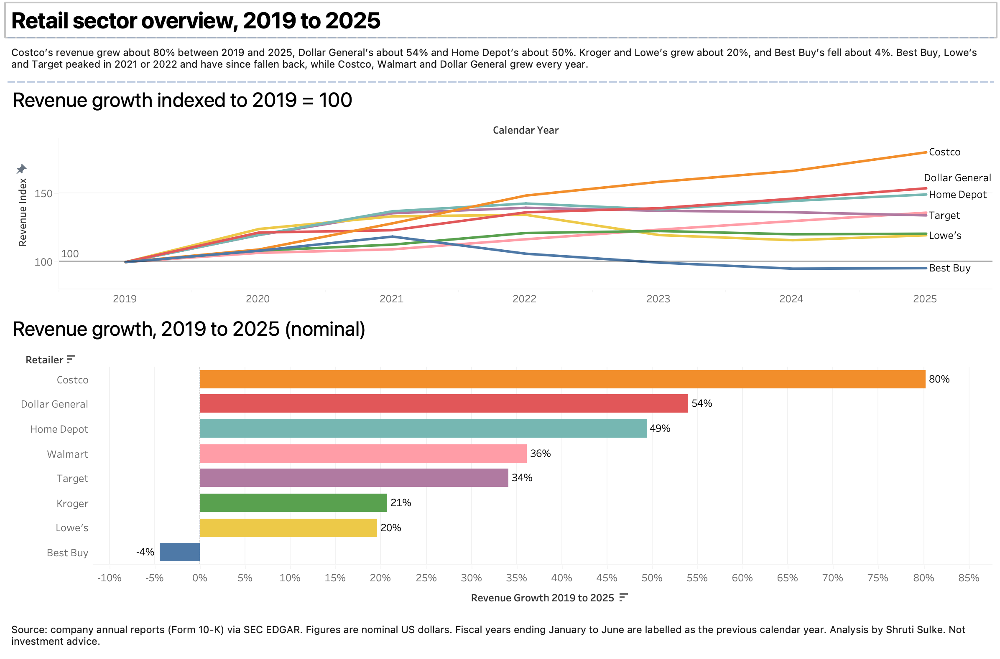

# US Retail Sector Analysis, 2019 to 2025

An analysis of eight US retailers (Walmart, Target, Costco, Kroger, Home Depot, Lowe's, Best Buy and Dollar General) over seven fiscal years, from their annual reports (Form 10-K). A Python script collects the figures from the SEC's public EDGAR data, and the analysis and dashboards are built in Tableau Public.

**Live dashboards and story:** [ADD TABLEAU PUBLIC LINK HERE]

## Questions
1. Who grew fastest, and how did retailers behave through the pandemic and recovery?
2. Did revenue growth go with better profitability?
3. How efficiently do they use inventory?
4. How much do they invest, and does it line up with their margins?

## Findings (nominal US dollars)
- Costco's revenue grew about 80% between 2019 and 2025, Dollar General's about 54% and Home Depot's about 49%. Kroger's and Lowe's grew about 20%, and Best Buy's fell about 4%.
- Best Buy, Lowe's and Target peaked in 2021 or 2022 and have since fallen back, while Costco, Walmart and Dollar General grew every year.
- Growth did not reliably bring profit. Dollar General's revenue rose 54% while its operating margin fell about 3 points, from 8.3% to 5.2%. Lowe's grew about 20% and gained about 3 points, to 11.8%.
- Home Depot has the highest operating margin throughout (12.7% to 15.3%), and Kroger the lowest (1.3% to 2.8%).
- Kroger and Costco turn inventory over about 16 and 13 times a year in 2025, against about 3 to 4 for Lowe's and Home Depot.
- Walmart's capital spending rose from about 2% to about 3.7% of revenue. Target's peaked at 5.1% in 2022 and Dollar General's at 4.4% in 2023, years in which their margins fell. This is association, not cause.

[KROGER NOTE: add one sentence on what you found about Kroger's 2025 operating margin in its annual report, or delete this line]

## Data and method
- Source: SEC EDGAR XBRL company facts (annual 10-K figures). The script `src/fetch_financials.py` pulls them, tries several reporting tags for each measure (companies use different ones) and records which tag it used.
- Fiscal years differ between companies, so each year is labelled by the calendar year most of it falls in: year-ends in January to June count as the previous year (Walmart's year ending January 2026 is "2025").
- Measures such as margins, growth, inventory turnover and capital spending as a share of revenue are calculated in Tableau. The formulas are in `docs/tableau_fields.txt`. `src/check_measures.py` recalculates them in Python as an independent check.
- Kroger reports no ordinary inventory line, so its inventory is derived as FIFO inventory minus the LIFO reserve. Its cost of revenue excludes depreciation.

## Limitations
- Eight companies over seven years, so findings are descriptive, not statistical.
- Figures are nominal, in US dollars, under US accounting rules, and are not inflation-adjusted.
- Gross margin is derived as revenue minus cost of revenue, so it can differ from company-reported figures. Costco's and Walmart's revenue includes membership and other income.
- Inventory turnover uses year-end inventory, not the yearly average, and companies use different inventory accounting methods.
- Operating margin may include one-off items.
- This is an exercise in analysis, not investment advice.

## Reproduce
1. `python3 -m venv .venv && source .venv/bin/activate && pip install pandas pyarrow certifi`
2. `SEC_USER_AGENT="Your Name your-email@example.com" python src/fetch_financials.py` (the SEC requires a User-Agent that identifies you)
3. `python src/check_measures.py` to print the main ratios
4. Open `data/clean/retail_financials_wide.csv` in Tableau and rebuild the fields from `docs/tableau_fields.txt`

## Data and licence
Financial data comes from companies' public filings with the US Securities and Exchange Commission, via EDGAR. The code is released under the MIT licence (see `LICENSE`).